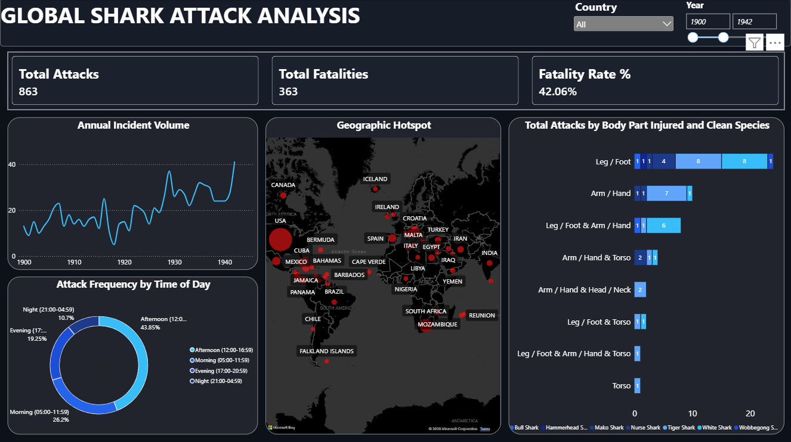

# 🦈 Shark Attack Data Analysis (1900 – Present)

## 📌 Project Overview
This project presents an end-to-end data analysis of over 100 years of global shark attack incidents. Raw data was extracted, cleaned, and transformed using Python (Pandas & RegEx) before performing exploratory querying with SQL and visualizing key spatio-temporal trends using Power BI.

---

## 🛠️ Tech Stack & Tools
* **Data Cleaning & Transformation:** Python (`pandas`, `re`, `numpy`)
* **Database & Querying:** SQL (`sqlite3`)
* **Data Visualization & Analytics:** Power BI Desktop, DAX
* **Environment:** VS Code, Jupyter Notebooks, Git & GitHub

---

## 📊 Dashboard Preview

---

## 🔍 Key Findings & Analytical Insights

1. **Annual Incident Trends:**
   * Reported attacks show a notable surge after 1950, peaking between 1990 and 2015.
   * This rise is attributed to increased global population, coastal tourism growth, and improved news reporting rather than heightened shark aggression.

2. **Geographic Hotspots:**
   * The vast majority of recorded attacks occur in the **USA**, **Australia**, and **South Africa**.
   * **Florida (USA)**, **New South Wales (Australia)**, and **KwaZulu-Natal (South Africa)** represent primary global hotspots.

3. **Body Parts Injured:**
   * **Legs & Feet** account for the highest proportion of injuries, followed by **Arms & Hands**, reflecting shallow-water activities like wading, surfing, and swimming.

4. **Time of Day:**
   * Incident volume concentrates during **Afternoon (12:00–16:59)** and **Morning (05:00–11:59)** hours, aligning directly with peak human recreational beach usage.

5. **Attacking Species:**
   * Where species were identified, **White Sharks**, **Tiger Sharks**, and **Bull Sharks** accounted for the vast majority of severe incidents.

---

## 📁 Repository Structure
